# Architecture

From the widest view to the narrowest. The last section maps where a new
project plugs in:

1. the system and what it talks to;
2. how it is deployed;
3. its layers;
4. its ports and adapters;
5. a run;
6. a batch;
7. the life of a migration;
8. the ETL's own tables;
9. adapting it to a project.

## 1. The system in its context

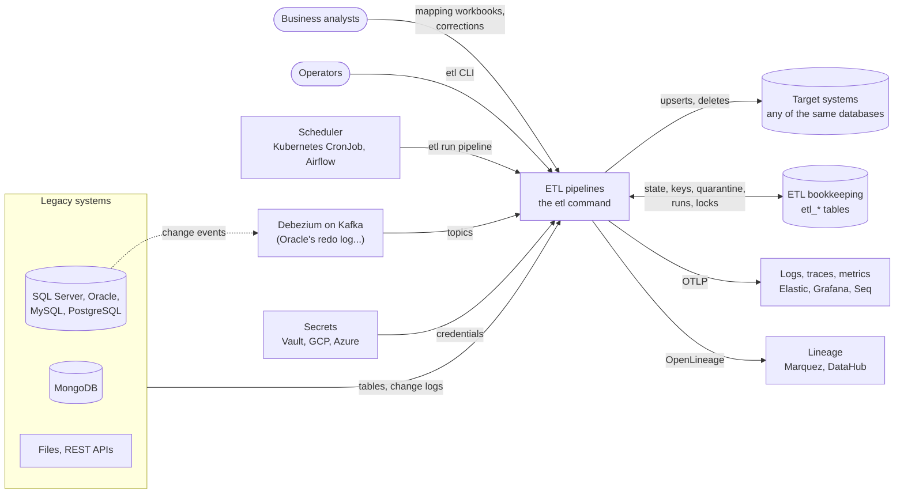

- **Its job.** The ETL reads legacy systems, maps their rows into the
  target's shape, checks them, loads them, and proves the result at cutover.
- **What it owns.** Only its bookkeeping, in a database of the settings:
  where each source was read up to, which keys are loaded, what was
  rejected, the history of runs. Everything else belongs to the source or
  the target.

## 2. Deployment

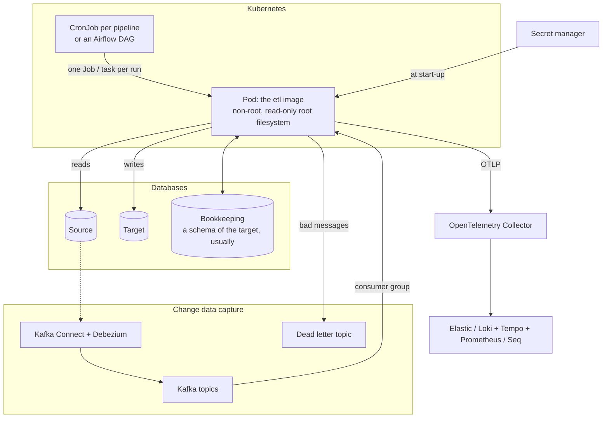

- **One image, one process per run.** A run is `etl run <module.pipeline>`.
  It holds a lock per step in the bookkeeping database, so that two
  schedulers, or two retries, never run a step twice at once.
- **The exit codes drive the scheduler.**
  - 0 or 3: done; 3 means rows were rejected, and only that (0 with
    `--partial-ok`).
  - 1: a step failed; retry.
  - 2: invalid settings, a pipeline that cannot be built, keys changed:
    fail at once.
  - 4: some of its steps are running elsewhere: fail, alert.
  - 130: cancelled.

  See {doc}`deployment`.
- **Bookkeeping.** It lives in a database the settings name
  (`bookkeeping.database`), or in files for a single host.

## 3. Layers

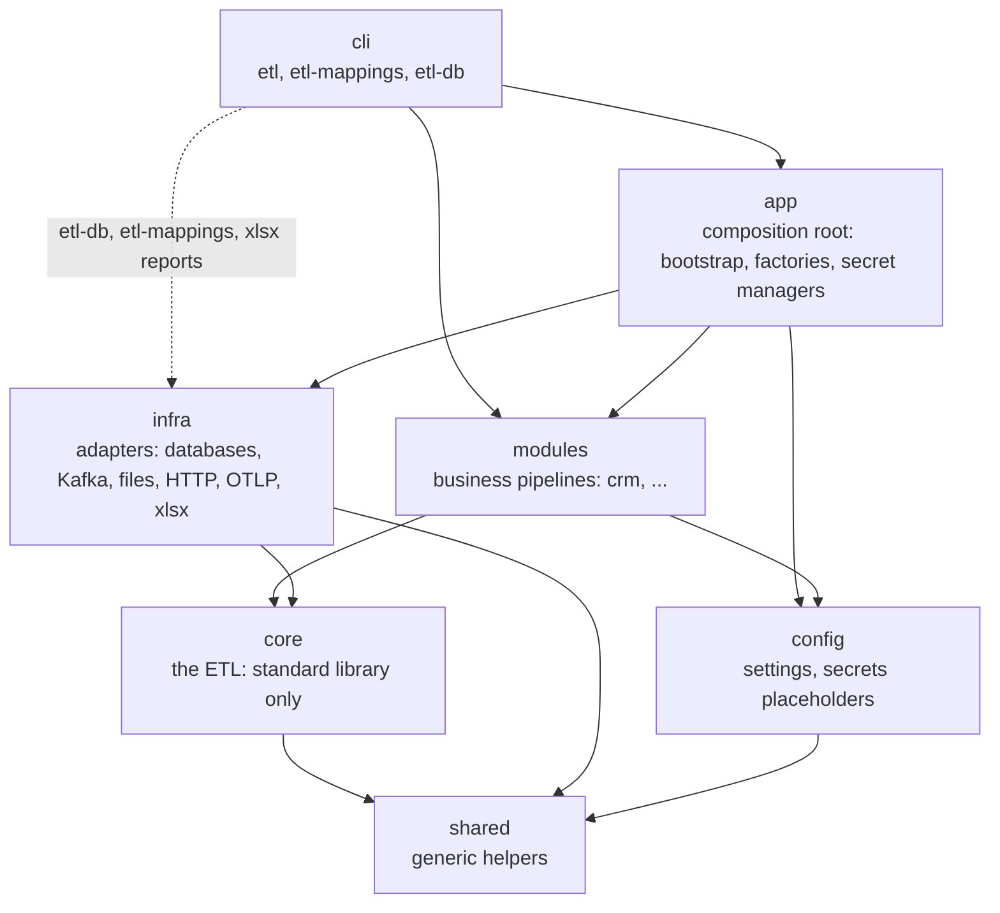

An arrow means "imports". `tests/units/test_architecture.py` enforces the
rules on every import; here are the ones that matter most:

- `core` imports no other layer, and no library beyond the standard one:
  the test holds it to an allow-list (`sys.stdlib_module_names`, `core`,
  `shared`), so a new library is refused before anyone thinks of
  forbidding it. `shared` is held to the standard library the same way,
  and `config` to it plus pydantic.
- `core.contract` imports no other part of `core`: the ports know nothing
  of the engine that calls them. `PipelineListener` is one of them, so an
  adapter such as the OpenLineage listener implements it from `infra`.
- `modules` never import `infra`: they get adapters as ports, from the
  resources.
- `infra` never imports `config` or `app`: it gets values, not settings.
- `cli` goes through `app` for anything built from the settings. It may
  import `infra.database`, `infra.mapping` and `infra.reports` itself (the
  dotted arrow): `etl-db` (DDL, discovery from `--url`) and `etl-mappings`
  (workbooks) run without settings, and the cutover report writes xlsx
  and parses connection strings to say where each database is.
  Each drives one adapter and composes nothing, so `app` would only pass
  the calls through. Any other part of `infra` fails the test.

`from core import mapping` counts as an import of `core.mapping`: the test
reads the imports the way the project writes them. `from x import *` is
refused anywhere: it hides what it imports from the rules.

Inside `core`:

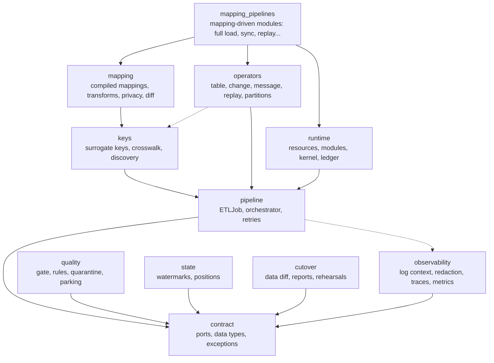

Each part imports only the parts below it, never one beside or above:
the test holds each to an allow-list (`CORE_LAYERS`), so a new edge is
refused until it is added there, and the list is ordered so that there is
no cycle. `quality`, `state` and `cutover` import `contract` only;
`observability` too (its run listeners implement
`contract.PipelineListener`), so the engine logs through it without a
cycle. `operators` also imports `keys` (the reconciliation canonicalises
keys as the registry does) and `observability` (the metrics of change
feeds). `mapping_pipelines` composes the others into the pipelines of a
module built from a mapping workbook; no other part of `core` imports it.

The same test refuses any cycle in `src/`: between two modules, or between
two parts of a package through different modules, at every level. Every
import counts, those of a `TYPE_CHECKING` block or of a function body too.
And there are none: every import is at the top of its module, so what a
module needs is what it imports, read at the top. The libraries the code
imports are dependencies of the package; only the drivers SQLAlchemy loads
by URL (SQL Server, Oracle, MySQL) are extras. Inside `contract`, the run context (`etl`) comes before the quality
contract, which audits it, and the result of a step (`results`), which
merges the quality reports, after both.

## 4. Ports and adapters

Every external system is behind a port of `core.contract`. The composition
root (`app.factories`) chooses the adapter from the settings, and the
modules ask for ports by name (`core.runtime.names`).

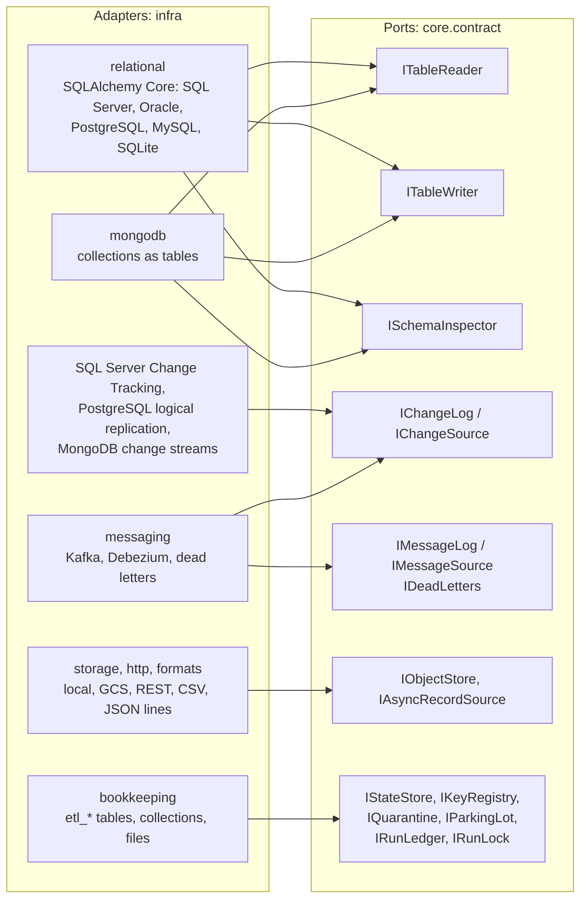

| Resource name | Port | Chosen by |
| --- | --- | --- |
| `reader.<db>`, `writer.<db>`, `inspector.<db>` | `ITableReader`, `ITableWriter`, `ISchemaInspector` | `databases.<db>.url`: relational or MongoDB |
| `changes.<db>` | `IChangeLog` | `databases.<db>.changes.kind`: `native` or `debezium` |
| `kafka.<name>` | `IMessageLog` | `kafka.<name>` |
| `store.<name>` | `IObjectStore` | `stores.<name>.kind`: `local` or `gcs` |
| `etl.state`, `etl.keys`, `etl.quarantine`, `etl.issues`, `etl.parking`, `etl.runs`, `etl.locks` | The bookkeeping ports | `bookkeeping.database`, or files |
| `etl.tables` | The database of the ETL's tables, checked (or upgraded, with `bookkeeping.create`) once per process | `bookkeeping.database` |

Ports have no setup or teardown: an adapter is ready once built, and what it
holds (a connection pool, a client) belongs to its resource, closed with the
process (`ResourceSpec.close`). Table readers live one run (`reader.<db>`
is a run resource), so that each run checks its read orders for NULLs once.
A change or message source returned by `IChangeLog.source` or
`IMessageLog.topic` may hold a consumer: whoever asked for it closes it
(`close`), as `ChangeExtractor` and `MessageExtractor` do in their teardown.
Only the components of a step (extractor, transformer, loader) have
`setup` and `teardown`, around each run of the step.

Messages are broker-neutral: an id, a key, a value, headers, a timestamp,
and an opaque position the source compares (`covers`) and confirms. Kafka's
partitions and offsets stay inside `infra.messaging.kafka`.

### Where types live

A type has one of three homes. What two layers or more share is a contract,
in `core.contract` (generic value types, `JsonValue`, in `shared.utils`).
What a package keeps to itself is in one file of each kind: `documents.py`
for the shapes it stores or serializes (the MongoDB documents, the compiled
mappings' JSON), `clients.py` for what it uses of a library's objects (the
Google, Azure and confluent-kafka SDKs, openpyxl), `types.py` for the rest
its modules share; only the package, `app`, the benchmarks and the tests
import these files. A module's own aliases stay in it, private. The
architecture tests refuse a `TypedDict`, a `Protocol` or a public alias
anywhere else, a package's file used by another package, and a public enum
out of `core.contract` and `cli.exit_codes`, unless it is listed with its
reason;
[the types reference](reference/types.md) shows them all.

## 5. A run

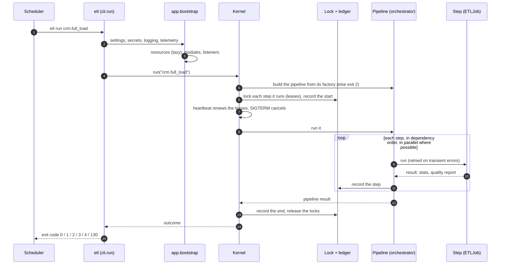

- **Every run is observable.** It is logged, traced and measured with its
  context, `etl.run_id`, `etl.pipeline` and `etl.step`. It is also sent as
  OpenLineage events, with the datasets each step reads and writes.
- **The ledger records what ran.** For every run: the user, the build, the
  hash of the settings, the hash of the mappings and of the keys, and the
  scheduler's label of the job (`etl runs`). Each step is recorded as soon
  as it ends, so a run that died still tells what it finished: `etl run
  --resume` runs only the rest.

### Several jobs, one pipeline

A run is one process. A load too large for one host is shared out by the
scheduler: several jobs (a Kubernetes Indexed Job, Airflow tasks), each
running some steps (`--step`), the key ranges of a partitioned table for
instance. There is no shared run between processes. The locks of the steps, in the
bookkeeping database, keep them apart:

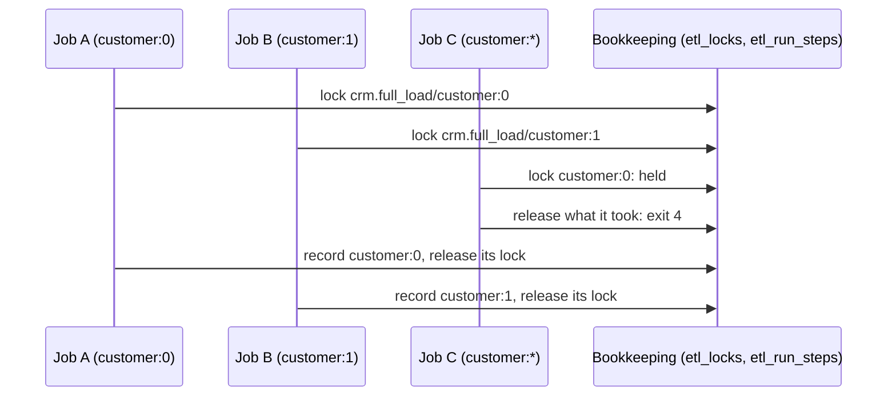

- **All or nothing.** A run takes the locks of all its steps, or none, and
  never waits for one: two runs cannot deadlock.
- **Key ranges.** `<mapping>:ranges` splits a partitioned table once, and
  saves the ranges; a range run before that fails, instead of splitting the
  table on its own. The first run of a range reads it in key order (the
  primary key's index is enough); the later runs read it by watermark, and
  want an index on `(watermark, key)`.
- **Retries.** `--label` names the scheduler's job; with `--resume` a retry
  resumes the run of its job. It waits, up to the lease, for the locks
  another try of the job holds: a dead try's expire, a live one's do not. See {doc}`adr/0010-steps-locked-scale-out-by-the-scheduler`.

## 6. A batch

Inside a step, `core.pipeline.ETLJob` streams its source batch by batch:

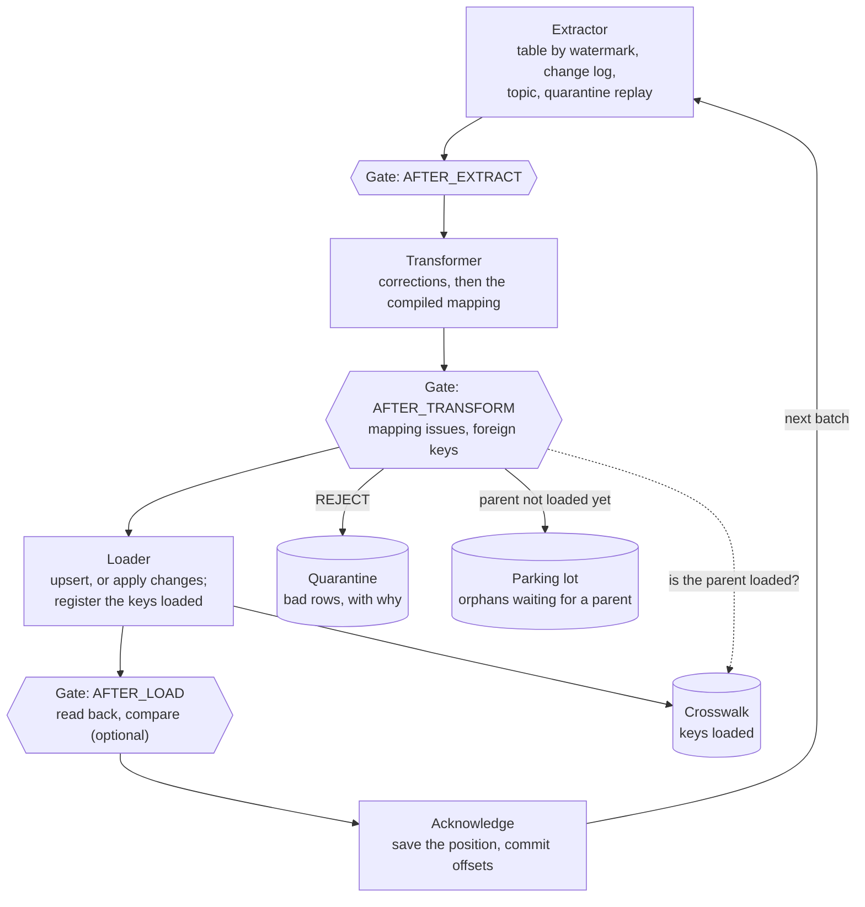

- **A batch is all or nothing.** It is written in one transaction, through
  a staging table and one set-based merge (bulk copy where the database has
  one).
- **Acknowledged means loaded.** A run that dies starts again from the last
  acknowledged batch. Loads are upserts by a deterministic key, so a batch
  loaded twice changes nothing: at-least-once, made idempotent.
- **Rejects never stop a run.** The circuit breaker (`max_reject_rate`)
  fails a batch that rejects too much, which is the sign of a broken
  mapping rather than of bad rows.
- **No path holds a table.** [Algorithms](algorithms.md) lists the paths
  that touch every row or key, each with its time and memory bound and the
  test or benchmark that proves it.

## 7. The life of a migration

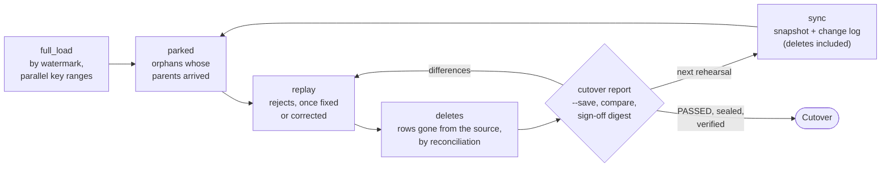

Each box is a pipeline of the module. Each runs on its own schedule, and
the locks of its steps keep one run of each step at a time. {doc}`cutover-runbook` gives the
commands.

## 8. The ETL's own tables

With `bookkeeping.database`, the ETL keeps its records in eight tables,
or in the same collections on MongoDB. `etl-db upgrade` creates them, or
brings them to the revision of the release (Alembic, its revision kept in
`etl_alembic_version`); `etl-db ddl` prints the same SQL for a DBA. See
{doc}`adr/0011-alembic-revisions-of-the-etl-tables`.

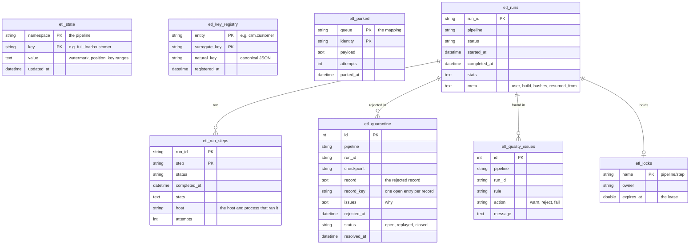

## 9. Adapting it to a project

Most of a new project is settings, workbooks and a module of about fifty
lines. The core changes only for something no project had before.

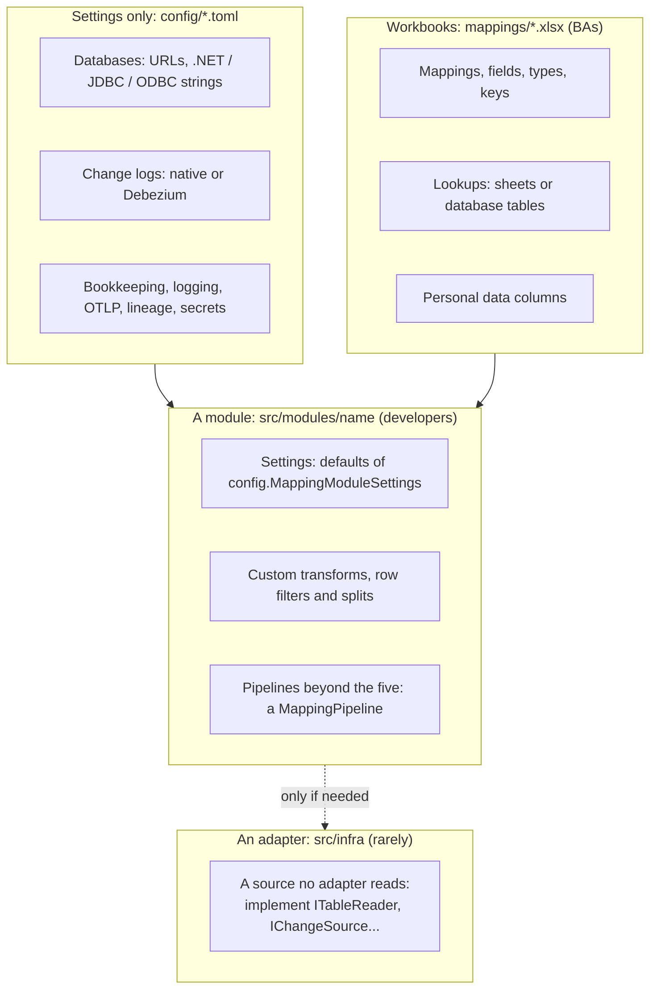

| What the project has | Where it goes |
| --- | --- |
| A legacy SQL Server, Oracle, MySQL, PostgreSQL or MongoDB | `databases.<name>.url`, as the legacy application writes it |
| The target system | Another `databases.<name>`, and its tables created by its own migrations |
| Changes to follow until the cutover | `databases.<name>.changes`: `native` (SQL Server, PostgreSQL, MongoDB) or `debezium` (Oracle, others) |
| Columns to map | A workbook: `etl-mappings template`, then `validate`, `compile`, `diff` |
| A rule no transform covers | A function in the module's `registry` (a `TransformRegistry`), which `etl-mappings --registry` then knows |
| A pipeline the five do not cover | A `core.mapping_pipelines.MappingPipeline` subclass, returned by the module's `pipelines` |
| Reference data in the source | `modules.<name>.settings.lookups` |
| Rows that need a manual fix | The module's corrections file |
| Large tables | `partitions` of the full load; jobs of the scheduler, each its ranges (`--step`), to share it between hosts; `make bench` on the project's own hardware, network and tables to size the window (one laptop's numbers in [performance](performance.md) size nothing else) |
| Personal data in UAT | The **Personal data** column, and `privacy.anonymize` |
| A scheduler | `deploy/k8s` (CronJobs) or `deploy/airflow` (a DAG) |
| Dashboards, alerts | `deploy/otel-collector`, `deploy/grafana` |
| A source no adapter reads | An adapter in `src/infra`, behind the ports, with the conformance suite of `tests/integrations` |

A new project goes through these steps:

1. `etl new-module <name>` writes the module, `src/modules/<name>`, and its
   workbook, `mappings/<name>.xlsx`.
2. Add the databases to `config/base.toml` and `config/<env>.toml`, with
   their secrets as placeholders. Check them with `etl check`.
3. `etl-db discover <schema>` suggests the keys and foreign keys of the
   legacy schema. It connects with `$ETL_DATABASE_URL` (or `--url`), not
   with the settings: a password on a command line ends up in shell
   histories. The BAs confirm the suggestions in the workbook.
4. Write the mappings, and compile them.
5. Run them: the module has the pipelines of `core.mapping_pipelines` (full load,
   sync, deletes, parked, replay) and the reconciliations of the cutover.
6. Rehearse with `etl run`, `etl quarantine`, then `etl cutover report
   --save`, and repeat until the report passes and is signed.

What a module writes, and what it gets:

| The module writes | `core.mapping_pipelines` gives it |
| --- | --- |
| A settings class, subclass of `config.MappingModuleSettings`, with its defaults (databases, compiled workbook) | Validation of every value, and of the pools its parallel ranges need |
| A `mapping.TransformRegistry` of its custom transforms | The compilation of its workbook, its lookup tables read from databases, its corrections |
| `create`, returning a `mapping_pipelines.MappingModule` | One step per mapping, in the order of the references, retried, with its lineage datasets |
| | The quality gate: mapping issues, references, orphans rejected or parked, the circuit breaker |
| | Surrogate keys registered, and in the fingerprint (`runtime.KEYS`) that stops a run whose keys changed |
| | `full_load`, `sync`, `parked`, `replay`, `deletes`, and the reconciliations of the cutover report |

That is four names to learn to add a module, and six more to write a
pipeline of its own: `MappingPipeline` and its `job`, `etl_job`, an
extractor of `core.operators`, the ports of `core.contract` and their
names (`runtime.names`). The CRM module is the same, with its own
transforms (`src/modules/crm`).
